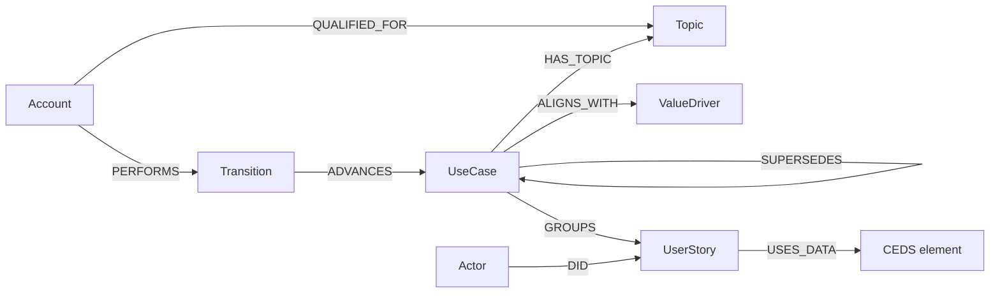

# Use Case Model

A use case groups the user stories that deliver one piece of value. Each user story
names one actor taking one step, and the data that step uses is tied to **CEDS
elements**. Other standards reach the same data through the CEDS concepts they
already map to in the EDUcore graph.



## Entities

### Topic
The subject area a use case belongs to. It also scopes who can review it.

| field | type | description |
| --- | --- | --- |
| `id` | string | unique key, e.g. `topic:transcripts` |
| `name` | string | display name |
| `description` | text | what the topic covers |
| `approved` | boolean | whether the topic is approved for use |

### ValueDriver
Why the work matters: the outcome a use case serves.

| field | type | description |
| --- | --- | --- |
| `id` | string | unique key |
| `name` | string | short statement of the value |
| `description` | text | the outcome and who benefits |

### UseCase
A goal that is reached through an ordered set of user stories. A use case is
immutable once it has been recorded; a change creates a new version that
`SUPERSEDES` the old one.

| field | type | description |
| --- | --- | --- |
| `id` | string | unique key, shared by all versions |
| `version` | integer | 1, 2, 3 … |
| `title` | string | the goal, in a few words |
| `description` | text | the scenario in plain language |
| `level` | enum `L0`–`L3` | maturity, raised one step at a time by transitions |
| `vetted` | boolean | true once reviewed and accepted at its current level |
| `precondition` | text | what must be true before it starts |
| `trigger` | text | the event that starts it |
| `guarantees` | text | what is true when it completes successfully |

### UserStory
One actor taking one step. A story can be reused by more than one use case.

| field | type | description |
| --- | --- | --- |
| `id` | string | unique key |
| `title` | string | short name for the step |
| `statement` | text | "As a … I want … so that …" |
| `acceptanceCriteria` | text[] | how to tell the step was done correctly |

### Actor
A person or system role that carries out user stories.

| field | type | description |
| --- | --- | --- |
| `id` | string | unique key |
| `name` | string | the role, e.g. "Registrar" |
| `kind` | enum `person` / `system` | whether the role is a person or a system |

### Account
A person who works on use cases.

| field | type | description |
| --- | --- | --- |
| `id` | string | unique key (the login account) |
| `name` | string | display name |
| `role` | enum `Contributor` / `Reviewer` / `Expert` | what the account may do |

### Transition
A recorded change to a use case's level.

| field | type | description |
| --- | --- | --- |
| `id` | string | unique key |
| `decision` | enum `advance` / `reject` | `advance` raises the level by one; `reject` lowers it to the previous level |
| `fromLevel` | enum `L0`–`L3` | level before |
| `toLevel` | enum `L0`–`L3` | level after |
| `rationale` | text | why: the actor's reason for the decision |
| `changeNote` | text | what: a summary of what changed |
| `at` | datetime | when it was recorded |

### CEDS element (existing)
Already in the graph: a CEDS property or option value, referenced by its CEDS id
(e.g. `P000128`, stored as `https://w3id.org/CEDStandards/terms/P000128`). User
stories point at it; nothing new is created.

## Relationships

| relationship | from → to | properties | meaning |
| --- | --- | --- | --- |
| `HAS_TOPIC` | UseCase → Topic | | the subject area of the use case |
| `ALIGNS_WITH` | UseCase → ValueDriver | | the value it delivers |
| `SUPERSEDES` | UseCase → UseCase | | this version replaces the earlier one |
| `GROUPS` | UseCase → UserStory | `order` (integer) | the stories, in sequence |
| `DID` | Actor → UserStory | | the actor who performs the step |
| `USES_DATA` | UserStory → CEDS element | `access` (`read` / `write` / `readWrite`), `required` (boolean), `note` | the data the step reads or produces |
| `QUALIFIED_FOR` | Account → Topic | | the account may review use cases in the topic |
| `PERFORMS` | Account → Transition | | who made the decision |
| `ADVANCES` | Transition → UseCase | | the use case (version) the decision applies to |

## Entering / importing

A use case is written as one JSON document. The full example, [example.json](example.json),
also declares the topics, value drivers, actors and a review transition it refers to.
Topics, value drivers, actors and CEDS elements are referenced by `id`, so an
existing one is linked rather than duplicated; user stories are written inline
and can be reused elsewhere by `id`.

```json
{
  "useCase": {
    "id": "uc:transcript-exchange",
    "version": 1,
    "title": "Send a transcript to another institution",
    "level": "L0",
    "vetted": false,
    "precondition": "The student has completed at least one term.",
    "trigger": "The student requests a transcript be sent.",
    "guarantees": "The receiving institution has a complete, verifiable record.",
    "topics": ["topic:transcripts"],
    "valueDrivers": ["vd:student-mobility"],
    "userStories": [
      {
        "id": "us:request-transcript",
        "order": 1,
        "actor": "actor:student",
        "title": "Request a transcript",
        "statement": "As a student I want to request my transcript be sent so that I can transfer.",
        "data": [
          { "ceds": "P001572", "access": "write", "required": true }
        ]
      }
    ]
  }
}
```

The same import as Cypher, which is what an importer would run:

```cypher
MERGE (uc:UseCase {id: 'uc:transcript-exchange', version: 1})
  SET uc.title = 'Send a transcript to another institution', uc.level = 'L0', uc.vetted = false,
      uc.precondition = 'The student has completed at least one term.',
      uc.trigger = 'The student requests a transcript be sent.',
      uc.guarantees = 'The receiving institution has a complete, verifiable record.'
MERGE (t:Topic {id: 'topic:transcripts'})       MERGE (uc)-[:HAS_TOPIC]->(t)
MERGE (v:ValueDriver {id: 'vd:student-mobility'}) MERGE (uc)-[:ALIGNS_WITH]->(v)
MERGE (s:UserStory {id: 'us:request-transcript'})
  SET s.title = 'Request a transcript',
      s.statement = 'As a student I want to request my transcript be sent so that I can transfer.'
MERGE (uc)-[g:GROUPS]->(s) SET g.order = 1
MERGE (a:Actor {id: 'actor:student'}) MERGE (a)-[:DID]->(s)
WITH s
MATCH (c:CedsProperty {stableId: 'https://w3id.org/CEDStandards/terms/' + 'P001572'})  // existing CEDS element
MERGE (s)-[d:USES_DATA]->(c) SET d.access = 'write', d.required = true
```

In the graph a CEDS property is a `CedsProperty` node whose `stableId` is its
CEDS term URI (`https://w3id.org/CEDStandards/terms/P001572`), so the short id
written in the JSON is expanded to that URI when linking.
