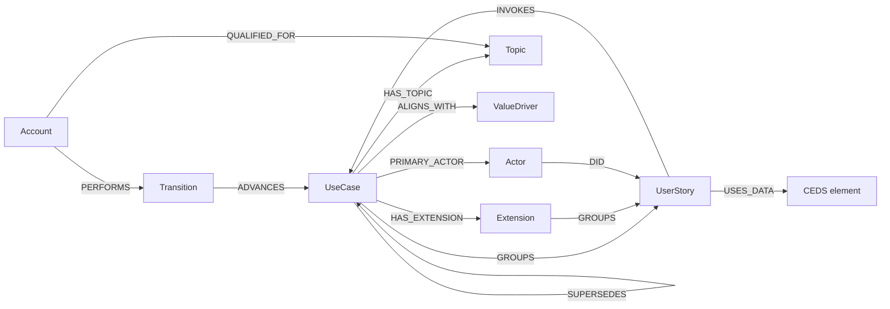

# Use Case Model

A Cockburn-style use case: a goal reached by a numbered main success scenario,
with extensions that branch off its steps. Each step is a user story, one actor
taking one step, and the data each step uses is tied to **CEDS elements**. Other
standards reach the same data through the CEDS concepts they already map to in
the EDUcore graph.



## How it maps to Cockburn's template

| Cockburn | this model |
| --- | --- |
| Use case number and name | `UseCase.id`, `UseCase.title` (the goal as a short active verb phrase) |
| Goal in context | `UseCase.description` |
| Scope | `UseCase.scope` |
| Level | `UseCase.goalLevel` |
| Primary actor | `PRIMARY_ACTOR` → Actor |
| Priority, Frequency | `UseCase.priority`, `UseCase.frequency` |
| Preconditions | `UseCase.precondition` |
| Success end condition | `UseCase.successGuarantees` |
| Failed end condition (minimal guarantees) | `UseCase.failureGuarantees` |
| Trigger | `UseCase.trigger` |
| Main success scenario | `GROUPS {order}` → UserStory; the actor of each step by `DID` |
| A step that is another use case ("use case 44") | `INVOKES` → UseCase |
| Used by | the reverse of `INVOKES` |
| Extensions (3a, 4a …) | `HAS_EXTENSION` → Extension, its own steps by `GROUPS {order}` |
| Variations | `GROUPS.variations` on the step |
| Other information | `UseCase.otherInformation` |
| Open issues | `UseCase.openIssues` |
| Schedule / due date | `UseCase.schedule` |

Added beyond Cockburn: the data each step uses (`USES_DATA` → CEDS), and the
review and versioning around a use case (Topic, ValueDriver, Account, Transition,
`SUPERSEDES`).

## Maturity: Cockburn's passes

Cockburn fills the template in passes. A use case's `maturity` says how far it
has got, and a use case can be advanced to a level only when that level's
fields are filled in.

| maturity | adds | fields |
| --- | --- | --- |
| `L0` | the goal | `title`, `description`, `scope`, `goalLevel`, primary actor, `priority`, `frequency` |
| `L1` | the main path | `trigger`, `precondition`, `successGuarantees`, main success scenario (at least one step) |
| `L2` | everything that can happen | extensions, variations, `failureGuarantees`, invoked use cases; the CEDS data of every step |
| `L3` | ready to plan | `otherInformation`, `openIssues`, `schedule` |

## Entities

### UseCase
A goal that a primary actor reaches through a system. A recorded version is not
changed; a change creates a new version that `SUPERSEDES` the old one.

| field | type | description |
| --- | --- | --- |
| `id` | string | unique key, shared by all versions |
| `version` | integer | 1, 2, 3 … |
| `title` | string | the goal as a short active verb phrase, e.g. "Send a transcript" |
| `description` | text | the goal in context: a longer statement of the goal |
| `scope` | string | the system under design, treated as a black box |
| `goalLevel` | enum `summary` / `userGoal` / `subfunction` | Cockburn's level: a summary goal spans several user goals; a user goal is one sitting for the primary actor; a subfunction is part of a user goal |
| `maturity` | enum `L0`–`L3` | how far the use case has been written (see above) |
| `vetted` | boolean | true once reviewed and accepted at its current maturity |
| `priority` | enum `high` / `medium` / `low` | how critical it is |
| `frequency` | string | how often it happens, e.g. "200 per day" |
| `precondition` | text | what must be true before it starts |
| `trigger` | text | the event that starts it (may be a time event) |
| `successGuarantees` | text | what is true when the goal is reached |
| `failureGuarantees` | text | what is still true when the goal is abandoned |
| `otherInformation` | text | timing, volumes and other non-functional notes |
| `openIssues` | text[] | questions not yet answered |
| `schedule` | string | the release or date it is due |

### UserStory
One actor taking one step. A story can be a step in more than one use case or
extension, and a step that is itself a goal `INVOKES` the lower-level use case
that achieves it.

| field | type | description |
| --- | --- | --- |
| `id` | string | unique key |
| `title` | string | the step as a short sentence, e.g. "Registrar assembles the transcript" |
| `statement` | text | "As a … I want … so that …" |
| `acceptanceCriteria` | text[] | how to tell the step was done correctly |

### Extension
A branch off one step of a use case's main success scenario: the condition, the
steps taken, and where it ends.

| field | type | description |
| --- | --- | --- |
| `id` | string | unique key |
| `label` | string | Cockburn's label, e.g. `3a` |
| `atStep` | integer | the main-scenario step (`GROUPS.order`) it branches from |
| `condition` | text | what is different, e.g. "The student has an unpaid hold" |
| `outcome` | enum `rejoin` / `success` / `failure` | rejoin the main scenario, end with the goal reached, or end without it |
| `rejoinAtStep` | integer | the main-scenario step it rejoins at (when `outcome` is `rejoin`) |

### Actor
A person or system role. It can be the primary actor of a use case, or the
actor who carries out a step.

| field | type | description |
| --- | --- | --- |
| `id` | string | unique key |
| `name` | string | the role, e.g. "Registrar" |
| `kind` | enum `person` / `system` | whether the role is a person or a system |

### Topic
The subject area a use case belongs to. It also scopes who can review it.

| field | type | description |
| --- | --- | --- |
| `id` | string | unique key, e.g. `topic:transcripts` |
| `name` | string | display name |
| `description` | text | what the topic covers |
| `approved` | boolean | whether the topic is approved for use |

### ValueDriver
Why the work matters: the outcome a use case serves.

| field | type | description |
| --- | --- | --- |
| `id` | string | unique key |
| `name` | string | short statement of the value |
| `description` | text | the outcome and who benefits |

### Account
A person who works on use cases.

| field | type | description |
| --- | --- | --- |
| `id` | string | unique key (the login account) |
| `name` | string | display name |
| `role` | enum `Contributor` / `Reviewer` / `Expert` | what the account may do |

### Transition
A recorded change to a use case's maturity.

| field | type | description |
| --- | --- | --- |
| `id` | string | unique key |
| `decision` | enum `advance` / `reject` | `advance` raises the maturity by one; `reject` lowers it to the previous level |
| `fromMaturity` | enum `L0`–`L3` | maturity before |
| `toMaturity` | enum `L0`–`L3` | maturity after |
| `rationale` | text | why: the reason for the decision |
| `changeNote` | text | what: a summary of what changed |
| `at` | datetime | when it was recorded |

### CEDS element (existing)
Already in the graph: a CEDS property, referenced by its CEDS id (e.g. `P000128`,
stored as `https://w3id.org/CEDStandards/terms/P000128`). Steps point at it;
nothing new is created.

## Relationships

| relationship | from → to | properties | meaning |
| --- | --- | --- | --- |
| `PRIMARY_ACTOR` | UseCase → Actor | | whose goal the use case serves |
| `HAS_TOPIC` | UseCase → Topic | | the subject area |
| `ALIGNS_WITH` | UseCase → ValueDriver | | the value it delivers |
| `SUPERSEDES` | UseCase → UseCase | | this version replaces the earlier one |
| `GROUPS` | UseCase → UserStory | `order` (integer), `variations` (text[]) | the main success scenario, in order; variations list the different ways the step may be done |
| `HAS_EXTENSION` | UseCase → Extension | | a branch off one of its steps |
| `GROUPS` | Extension → UserStory | `order` (integer), `variations` (text[]) | the extension's steps (3a1, 3a2 …) |
| `INVOKES` | UserStory → UseCase | | the step is achieved by that lower-level use case |
| `DID` | Actor → UserStory | | the actor who carries out the step |
| `USES_DATA` | UserStory → CEDS element | `access` (`read` / `write` / `readWrite`), `required` (boolean), `note` | the data the step reads or produces |
| `QUALIFIED_FOR` | Account → Topic | | the account may review use cases in the topic |
| `PERFORMS` | Account → Transition | | who made the decision |
| `ADVANCES` | Transition → UseCase | | the use case (version) the decision applies to |

## Entering / importing

A use case is written as one JSON document. The full example,
[example.json](example.json), also declares the topics, value drivers, actors,
an invoked subfunction use case and a review transition. Topics, value drivers,
actors, use cases and CEDS elements are referenced by `id`, so existing ones are
linked rather than duplicated. Steps are written inline and can be reused
elsewhere by `id`.

A step in the JSON (main scenario or extension):

```json
{
  "id": "us:request-transcript",
  "order": 1,
  "actor": "actor:student",
  "title": "Student requests a transcript be sent",
  "statement": "As a student I want to request my transcript be sent so that I can transfer.",
  "variations": ["online portal", "paper form", "third-party clearinghouse"],
  "invokes": "uc:verify-student-identity",
  "data": [
    { "ceds": "P001572", "access": "write", "required": true }
  ]
}
```

An extension:

```json
{
  "id": "ext:transcript-exchange-2a",
  "label": "2a",
  "atStep": 2,
  "condition": "The student has an unpaid hold.",
  "outcome": "failure",
  "steps": [
    { "id": "us:notify-hold", "order": 1, "actor": "actor:registrar", "title": "Registrar tells the student about the hold" }
  ]
}
```

The same import as Cypher, which is what an importer would run (one step and
one extension shown):

```cypher
MERGE (uc:UseCase {id: 'uc:transcript-exchange', version: 1})
  SET uc.title = 'Send a transcript to another institution',
      uc.scope = 'Sending institution student information system',
      uc.goalLevel = 'userGoal', uc.maturity = 'L2', uc.vetted = false,
      uc.priority = 'high', uc.frequency = 'About 300 per week, peaking at term end',
      uc.precondition = 'The student has completed at least one term.',
      uc.trigger = 'The student requests a transcript be sent.',
      uc.successGuarantees = 'The receiving institution has a complete, verifiable record.',
      uc.failureGuarantees = 'No record has left the institution; the student knows why.'
MERGE (pa:Actor {id: 'actor:student'})            MERGE (uc)-[:PRIMARY_ACTOR]->(pa)
MERGE (t:Topic {id: 'topic:transcripts'})         MERGE (uc)-[:HAS_TOPIC]->(t)
MERGE (v:ValueDriver {id: 'vd:student-mobility'}) MERGE (uc)-[:ALIGNS_WITH]->(v)

// step 1 of the main success scenario
MERGE (s:UserStory {id: 'us:request-transcript'})
  SET s.title = 'Student requests a transcript be sent',
      s.statement = 'As a student I want to request my transcript be sent so that I can transfer.'
MERGE (uc)-[g:GROUPS]->(s)
  SET g.order = 1, g.variations = ['online portal', 'paper form', 'third-party clearinghouse']
MERGE (pa)-[:DID]->(s)
MERGE (sub:UseCase {id: 'uc:verify-student-identity', version: 1}) MERGE (s)-[:INVOKES]->(sub)
WITH uc, s
MATCH (c:CedsProperty {stableId: 'https://w3id.org/CEDStandards/terms/' + 'P001572'})  // existing CEDS element
MERGE (s)-[d:USES_DATA]->(c) SET d.access = 'write', d.required = true

// extension 2a
WITH uc
MERGE (x:Extension {id: 'ext:transcript-exchange-2a'})
  SET x.label = '2a', x.atStep = 2, x.condition = 'The student has an unpaid hold.', x.outcome = 'failure'
MERGE (uc)-[:HAS_EXTENSION]->(x)
MERGE (xs:UserStory {id: 'us:notify-hold'}) SET xs.title = 'Registrar tells the student about the hold'
MERGE (x)-[xg:GROUPS]->(xs) SET xg.order = 1
MERGE (r:Actor {id: 'actor:registrar'}) MERGE (r)-[:DID]->(xs)
```

In the graph a CEDS property is a `CedsProperty` node whose `stableId` is its
CEDS term URI (`https://w3id.org/CEDStandards/terms/P001572`), so the short id
written in the JSON is expanded to that URI when linking.
