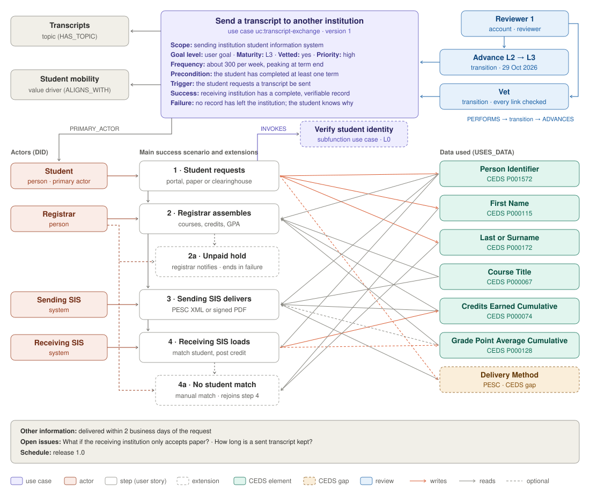
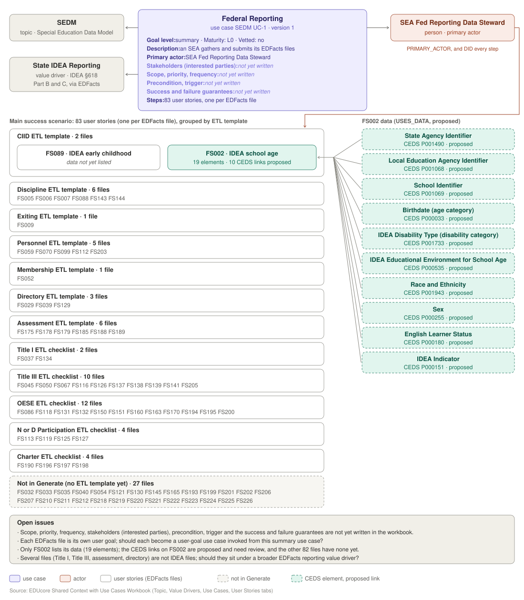
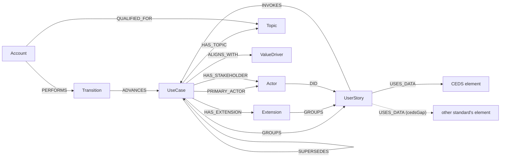

# Use Case Model

A Cockburn-style use case: a goal reached by a numbered main success scenario,
with extensions that branch off its steps. Each step is a user story, one actor
taking one step, and the data each step uses is tied to **CEDS elements**. Other
standards reach the same data through the CEDS concepts they already map to in
the EDUcore graph. Where CEDS has no element for the data, a step may use another
standard's element instead; that link is flagged as a **CEDS gap** so the element
can be proposed to CEDS later.

**For discussion**

1. [Two worked examples](#two-worked-examples), drawn in full
2. [The model](#the-model): how it maps to Cockburn's template and to the shared-context workbook
3. [Decisions so far](#decisions-so-far) and [open questions](#open-questions)
4. [Changes from the first diagram](#changes-from-the-first-diagram)
5. Reference: [maturity](#maturity-cockburns-passes), [entities](#entities),
   [relationships](#relationships), [entering and importing](#entering-and-importing)

## Two worked examples

### Send a transcript to another institution

A complete use case at maturity L3: context (topic, value driver, stakeholders,
review history), the actors, four steps with variations, two extensions, an
invoked subfunction use case, and the CEDS data each step reads or writes,
including one CEDS gap. Data: [example.json](example.json).



### SEDM Federal Reporting

Built from the *EDUcore Shared Context with Use Cases Workbook* (Topic, Value
Drivers, Use Cases and User Stories tabs): topic SEDM, value driver State IDEA
Reporting, use case SEDM UC-1 Federal Reporting, and its 83 user stories, one per
EDFacts file, all by the SEA Fed Reporting Data Steward. The workbook has not yet
filled in the use case's Cockburn fields, so it is at maturity `L0`, and the gaps
are listed in its open issues. Data:
[sedm-federal-reporting.json](sedm-federal-reporting.json).

Workbook columns with no field in this model are carried on each step as
`edfactsFile`, `resources` (the file specification and ETL template), `notes`
(in Generate or not) and `dataNote`. Only FS002 gives its data (19 elements); the
ten CEDS links on it are proposed for review, not taken from the workbook.



## The model



### How it maps to Cockburn's template

| Cockburn | this model |
| --- | --- |
| Use case number and name | `UseCase.id`, `UseCase.title` (the goal as a short active verb phrase) |
| Goal in context | `UseCase.description` |
| Scope | `UseCase.scope` |
| Level | `UseCase.goalLevel` |
| Primary actor | `PRIMARY_ACTOR` → Actor |
| Stakeholders and interests | `HAS_STAKEHOLDER {interest}` → Actor |
| Priority, Frequency | `UseCase.priority`, `UseCase.frequency` |
| Preconditions | `UseCase.precondition` |
| Success end condition | `UseCase.successGuarantees` |
| Failed end condition (minimal guarantees) | `UseCase.failureGuarantees` |
| Trigger | `UseCase.trigger` |
| Main success scenario | `GROUPS {order}` → UserStory; the actor of each step by `DID` |
| A step that is another use case ("use case 44") | `INVOKES` → UseCase |
| Used by | the reverse of `INVOKES` |
| Extensions (3a, 4a …) | `HAS_EXTENSION` → Extension, its own steps by `GROUPS {order}` |
| Variations | `GROUPS.variations` on the step |
| Other information | `UseCase.otherInformation` |
| Open issues | `UseCase.openIssues` |
| Schedule / due date | `UseCase.schedule` |

Added beyond Cockburn: the data each step uses (`USES_DATA` → CEDS), and the
review and versioning around a use case (Topic, ValueDriver, Account, Transition,
`SUPERSEDES`).

Stakeholders are actors too: an interested party is an Actor linked to the use
case by `HAS_STAKEHOLDER`, with its interest on the link. The same Actor can be
the primary actor, carry out steps, or only have an interest in the outcome (an
auditor, a privacy office, a federal agency receiving a report).

### How it maps to the shared-context workbook

**Use Cases tab**

| workbook column | this model |
| --- | --- |
| Topic, Value Driver | `HAS_TOPIC` → Topic, `ALIGNS_WITH` → ValueDriver |
| Use Case ID, Use Case | `UseCase.id`, `UseCase.title` |
| Use Case Description | `UseCase.description` |
| Scope | `UseCase.scope` |
| Primary Actor | `PRIMARY_ACTOR` → Actor |
| Interested Parties, Stakeholders | `HAS_STAKEHOLDER {interest}` → Actor |
| Main Success Scenario | the use case's user stories, in order (`GROUPS`) |
| Extensions | Extension |
| Variations | `GROUPS.variations` |
| Preconditions, Trigger | `UseCase.precondition`, `UseCase.trigger` |
| Success Guarantee, Minimum Guarantee | `UseCase.successGuarantees`, `UseCase.failureGuarantees` |
| Related Use Cases | `INVOKES` (and its reverse, "used by") |
| Frequency, Other Information | `UseCase.frequency`, `UseCase.otherInformation` |
| Data Objects | the data of its steps (`USES_DATA`) |
| Process Invariants | *no field yet* (see open questions) |
| Resource(s) | *no field yet* (see open questions) |

**User Stories tab**

| workbook column | this model |
| --- | --- |
| User Story ID, User Story Title | `UserStory.id`, `UserStory.title` |
| Use Case | the use case that `GROUPS` it |
| Actor ("As a …") | `DID` from the Actor |
| Intention ("I want to …") | `UserStory.statement` |
| Description of Data Elements Needed | `USES_DATA` → CEDS elements |
| Resource 1, Resource 2, Notes | *no field yet*; carried as `resources` and `notes` in the SEDM example |

**Actors, Topic and Value Drivers tabs** map to Actor, Topic and ValueDriver.

## Decisions so far

| question | decision |
| --- | --- |
| Data with no CEDS element | Allowed: the step links another standard's element, and the link is flagged `cedsGap` so it can be proposed to CEDS later. |
| Reusable steps vs versioned use cases | Versioned use cases win. Steps belong to one use case version; shared steps become subfunction use cases reached by `INVOKES`. |
| Rejection | Drops the maturity by one level. |
| What `vetted` means | A person has reviewed the use case and its connections after it was uploaded. |
| Who can advance | Any account, including Contributors. |
| Stakeholders and interests | Kept, as a kind of actor: `HAS_STAKEHOLDER {interest}` from the use case to an Actor. |

## Open questions

**On the model**

1. **Process invariants.** The workbook has a Process Invariants column (what
   must stay true throughout, e.g. "no record is disclosed without consent").
   Add it as a `UseCase.invariants` field?
2. **Resources.** Both the Use Cases and User Stories tabs list resources (file
   specifications, ETL templates, slides). Add `resources` (links) to UseCase and
   UserStory, or keep them outside the model?
3. **Data at the use case level.** The workbook's Data Objects column describes
   a use case's data; this model records data only on steps. Is the union of the
   steps' data enough, or should a use case name its data objects directly?

**On the SEDM example**

4. **Use case level.** Federal Reporting's 83 stories are separate file
   submissions, not a sequence. Should Federal Reporting be a summary use case
   that invokes one user-goal use case per EDFacts file?
5. **Value driver fit.** Many of the files are not IDEA files (Title I,
   Title III, assessment, directory, charter). Should they sit under a broader
   EDFacts reporting value driver?
6. **Actor names.** The Actors tab lists "IDEA Administrator" for SEDM; every
   Federal Reporting story uses "SEA Fed Reporting Data Steward". Are these the
   same role?
7. **Stakeholders.** The workbook leaves them blank. Likely candidates: the U.S.
   Department of Education (OSEP), LEAs, families.
8. **FS002 data.** Do the ten proposed CEDS elements match the 19 elements of
   FS002, and who will list the data of the other 82 files?

## Changes from the first diagram

- **Data artifact → data at the step.** The diagram's data artifact (any forged
  element or hub reference) is now `USES_DATA` from each user story, to a CEDS
  element first, or to another standard's element flagged as a CEDS gap.
- **`level` → `maturity`**, gated by Cockburn's passes; Cockburn's own level
  is the new `goalLevel`.
- **Cockburn fields added**: scope, goal level, primary actor, priority,
  frequency, failure guarantees, other information, open issues, schedule.
- **Stakeholders** are actors with an interest (`HAS_STAKEHOLDER {interest}`);
  an actor can now be an organization as well as a person or system.
- **Extensions, variations and `INVOKES`** added, so a scenario can branch and
  a step can be a lower-level use case.
- **User stories are the steps**, and belong to one use case version.
- **Transition** gains a `vet` decision.
- **Direction** of two relationships: `UseCase -HAS_TOPIC-> Topic` and
  `Actor -DID-> UserStory`.

## Maturity: Cockburn's passes

Cockburn fills the template in passes. A use case's `maturity` says how far it
has got, and a use case can be advanced to a level only when that level's
fields are filled in.

| maturity | adds | fields |
| --- | --- | --- |
| `L0` | the goal | `title`, `description`, `scope`, `goalLevel`, primary actor, `priority`, `frequency` |
| `L1` | the main path | `trigger`, `precondition`, `successGuarantees`, main success scenario (at least one step) |
| `L2` | everything that can happen | stakeholders and their interests, extensions, variations, `failureGuarantees`, invoked use cases; the data of every step (CEDS, or another standard's element flagged as a CEDS gap) |
| `L3` | ready to plan | `otherInformation`, `openIssues`, `schedule` |

## Entities

### UseCase
A goal that a primary actor reaches through a system. A recorded version is not
changed; a change creates a new version that `SUPERSEDES` the old one. Each
version has its own steps and extensions, so changing a step in version 2 never
alters version 1.

| field | type | description |
| --- | --- | --- |
| `id` | string | unique key, shared by all versions |
| `version` | integer | 1, 2, 3 … |
| `title` | string | the goal as a short active verb phrase, e.g. "Send a transcript" |
| `description` | text | the goal in context: a longer statement of the goal |
| `scope` | string | the system under design, treated as a black box |
| `goalLevel` | enum `summary` / `userGoal` / `subfunction` | Cockburn's level: a summary goal spans several user goals; a user goal is one sitting for the primary actor; a subfunction is part of a user goal |
| `maturity` | enum `L0`–`L3` | how far the use case has been written (see above) |
| `vetted` | boolean | true once a person has reviewed the use case and its connections (actors, invoked use cases, data links) after it was uploaded; always false on import, set by a `vet` transition |
| `priority` | enum `high` / `medium` / `low` | how critical it is |
| `frequency` | string | how often it happens, e.g. "200 per day" |
| `precondition` | text | what must be true before it starts |
| `trigger` | text | the event that starts it (may be a time event) |
| `successGuarantees` | text | what is true when the goal is reached |
| `failureGuarantees` | text | what is still true when the goal is abandoned |
| `otherInformation` | text | timing, volumes and other non-functional notes |
| `openIssues` | text[] | questions not yet answered |
| `schedule` | string | the release or date it is due |

### UserStory
One actor taking one step. A story belongs to one version of one use case (in
its main scenario or one of its extensions); a new version gets its own copies.
To share a step between use cases, write it as a subfunction use case and have
each step that needs it `INVOKES` it, Cockburn's way.

| field | type | description |
| --- | --- | --- |
| `id` | string | unique key |
| `title` | string | the step as a short sentence, e.g. "Registrar assembles the transcript" |
| `statement` | text | "As a … I want … so that …" |
| `acceptanceCriteria` | text[] | how to tell the step was done correctly |

### Extension
A branch off one step of a use case's main success scenario: the condition, the
steps taken, and where it ends.

| field | type | description |
| --- | --- | --- |
| `id` | string | unique key |
| `label` | string | Cockburn's label, e.g. `3a` |
| `atStep` | integer | the main-scenario step (`GROUPS.order`) it branches from |
| `condition` | text | what is different, e.g. "The student has an unpaid hold" |
| `outcome` | enum `rejoin` / `success` / `failure` | rejoin the main scenario, end with the goal reached, or end without it |
| `rejoinAtStep` | integer | the main-scenario step it rejoins at (when `outcome` is `rejoin`) |

### Actor
A person, system or organization role. In a use case an actor can be the
primary actor, carry out steps (`DID`), or be a stakeholder with an interest in
the outcome (`HAS_STAKEHOLDER`); one actor can play several of these parts.

| field | type | description |
| --- | --- | --- |
| `id` | string | unique key |
| `name` | string | the role, e.g. "Registrar" |
| `kind` | enum `person` / `system` / `organization` | what kind of party the role is |

### Topic
The subject area a use case belongs to. It also scopes who can review it.

| field | type | description |
| --- | --- | --- |
| `id` | string | unique key, e.g. `topic:transcripts` |
| `name` | string | display name |
| `description` | text | what the topic covers |
| `approved` | boolean | whether the topic is approved for use |

### ValueDriver
Why the work matters: the outcome a use case serves.

| field | type | description |
| --- | --- | --- |
| `id` | string | unique key |
| `name` | string | short statement of the value |
| `description` | text | the outcome and who benefits |

### Account
A person who works on use cases.

| field | type | description |
| --- | --- | --- |
| `id` | string | unique key (the login account) |
| `name` | string | display name |
| `role` | enum `Contributor` / `Reviewer` / `Expert` | the account's standing; every role may add use cases and advance, reject or vet them |

### Transition
A recorded review decision on a use case version.

| field | type | description |
| --- | --- | --- |
| `id` | string | unique key |
| `decision` | enum `advance` / `reject` / `vet` | `advance` raises the maturity by one; `reject` lowers it by one; `vet` marks the upload reviewed and leaves the maturity as it is |
| `fromMaturity` | enum `L0`–`L3` | maturity before |
| `toMaturity` | enum `L0`–`L3` | maturity after |
| `rationale` | text | why: the reason for the decision |
| `changeNote` | text | what: a summary of what changed |
| `at` | datetime | when it was recorded |

### Data element (existing)
Already in the graph; steps point at it and nothing new is created.

- **CEDS element**: a CEDS property, referenced by its CEDS id (e.g. `P000128`,
  stored as `https://w3id.org/CEDStandards/terms/P000128`).
- **Other standard's element**: any forged element, referenced by its `stableId`
  (e.g. `pesc:field/AcademicRecord/RecipientType.element.DeliveryMethod`), used
  only when CEDS has nothing for the data. Its `USES_DATA` link is flagged
  `cedsGap`.

## Relationships

| relationship | from → to | properties | meaning |
| --- | --- | --- | --- |
| `PRIMARY_ACTOR` | UseCase → Actor | | whose goal the use case serves |
| `HAS_STAKEHOLDER` | UseCase → Actor | `interest` (text) | a party with an interest in the outcome, and what it needs protected or delivered |
| `HAS_TOPIC` | UseCase → Topic | | the subject area |
| `ALIGNS_WITH` | UseCase → ValueDriver | | the value it delivers |
| `SUPERSEDES` | UseCase → UseCase | | this version replaces the earlier one |
| `GROUPS` | UseCase → UserStory | `order` (integer), `variations` (text[]) | the main success scenario, in order; variations list the different ways the step may be done |
| `HAS_EXTENSION` | UseCase → Extension | | a branch off one of its steps |
| `GROUPS` | Extension → UserStory | `order` (integer), `variations` (text[]) | the extension's steps (3a1, 3a2 …) |
| `INVOKES` | UserStory → UseCase | | the step is achieved by that lower-level use case |
| `DID` | Actor → UserStory | | the actor who carries out the step |
| `USES_DATA` | UserStory → data element | `access` (`read` / `write` / `readWrite`), `required` (boolean), `note`, `cedsGap` (boolean) | the data the step reads or produces; `cedsGap` is set by the importer when the element is not a CEDS element |
| `QUALIFIED_FOR` | Account → Topic | | the account may review use cases in the topic |
| `PERFORMS` | Account → Transition | | who made the decision |
| `ADVANCES` | Transition → UseCase | | the use case (version) the decision applies to |

## Entering and importing

A use case is written as one JSON document, like the two examples above. Topics,
value drivers, actors, use cases and CEDS elements are referenced by `id`, so
existing ones are linked rather than duplicated. Steps and extensions are written
inline inside their use case.

A step in the JSON (main scenario or extension):

```json
{
  "id": "us:request-transcript",
  "order": 1,
  "actor": "actor:student",
  "title": "Student requests a transcript be sent",
  "statement": "As a student I want to request my transcript be sent so that I can transfer.",
  "variations": ["online portal", "paper form", "third-party clearinghouse"],
  "invokes": "uc:verify-student-identity",
  "data": [
    { "ceds": "P001572", "access": "write", "required": true },
    { "element": "pesc:field/AcademicRecord/RecipientType.element.DeliveryMethod", "access": "write", "required": false,
      "note": "How the transcript is to be delivered; no CEDS element" }
  ]
}
```

A data item is either `"ceds"` (a CEDS id) or `"element"` (another standard's
stableId, imported as a CEDS gap).

A stakeholder, listed on the use case:

```json
{ "actor": "actor:receiving-institution", "interest": "A complete record it can verify came from the sending institution." }
```

An extension:

```json
{
  "id": "ext:transcript-exchange-2a",
  "label": "2a",
  "atStep": 2,
  "condition": "The student has an unpaid hold.",
  "outcome": "failure",
  "steps": [
    { "id": "us:notify-hold", "order": 1, "actor": "actor:registrar", "title": "Registrar tells the student about the hold" }
  ]
}
```

The same import as Cypher, which is what an importer would run (one stakeholder,
one step and one extension shown):

```cypher
MERGE (uc:UseCase {id: 'uc:transcript-exchange', version: 1})
  SET uc.title = 'Send a transcript to another institution',
      uc.scope = 'Sending institution student information system',
      uc.goalLevel = 'userGoal', uc.maturity = 'L2', uc.vetted = false,
      uc.priority = 'high', uc.frequency = 'About 300 per week, peaking at term end',
      uc.precondition = 'The student has completed at least one term.',
      uc.trigger = 'The student requests a transcript be sent.',
      uc.successGuarantees = 'The receiving institution has a complete, verifiable record.',
      uc.failureGuarantees = 'No record has left the institution; the student knows why.'
MERGE (pa:Actor {id: 'actor:student'})            MERGE (uc)-[:PRIMARY_ACTOR]->(pa)
MERGE (ri:Actor {id: 'actor:receiving-institution'}) SET ri.kind = 'organization'
MERGE (uc)-[h:HAS_STAKEHOLDER]->(ri) SET h.interest = 'A complete record it can verify came from the sending institution.'
MERGE (t:Topic {id: 'topic:transcripts'})         MERGE (uc)-[:HAS_TOPIC]->(t)
MERGE (v:ValueDriver {id: 'vd:student-mobility'}) MERGE (uc)-[:ALIGNS_WITH]->(v)

// step 1 of the main success scenario
MERGE (s:UserStory {id: 'us:request-transcript'})
  SET s.title = 'Student requests a transcript be sent',
      s.statement = 'As a student I want to request my transcript be sent so that I can transfer.'
MERGE (uc)-[g:GROUPS]->(s)
  SET g.order = 1, g.variations = ['online portal', 'paper form', 'third-party clearinghouse']
MERGE (pa)-[:DID]->(s)
MERGE (sub:UseCase {id: 'uc:verify-student-identity', version: 1}) MERGE (s)-[:INVOKES]->(sub)
WITH uc, s
MATCH (c:CedsProperty {stableId: 'https://w3id.org/CEDStandards/terms/' + 'P001572'})  // existing CEDS element
MERGE (s)-[d:USES_DATA]->(c) SET d.access = 'write', d.required = true

// extension 2a
WITH uc
MERGE (x:Extension {id: 'ext:transcript-exchange-2a'})
  SET x.label = '2a', x.atStep = 2, x.condition = 'The student has an unpaid hold.', x.outcome = 'failure'
MERGE (uc)-[:HAS_EXTENSION]->(x)
MERGE (xs:UserStory {id: 'us:notify-hold'}) SET xs.title = 'Registrar tells the student about the hold'
MERGE (x)-[xg:GROUPS]->(xs) SET xg.order = 1
MERGE (r:Actor {id: 'actor:registrar'}) MERGE (r)-[:DID]->(xs)
```

In the graph a CEDS property is a `CedsProperty` node whose `stableId` is its
CEDS term URI (`https://w3id.org/CEDStandards/terms/P001572`), so the short id
written in the JSON is expanded to that URI when linking. A non-CEDS element is
linked the same way and flagged:

```cypher
MATCH (s:UserStory {id: 'us:request-transcript'})
MATCH (e:ForgedNode {stableId: 'pesc:field/AcademicRecord/RecipientType.element.DeliveryMethod'})
MERGE (s)-[d:USES_DATA]->(e)
  SET d.access = 'write', d.required = false, d.cedsGap = NOT e:CedsProperty
```

The CEDS gaps to propose, with the use cases that need them:

```cypher
MATCH (uc:UseCase)-[:GROUPS|HAS_EXTENSION*1..2]->(s:UserStory)-[d:USES_DATA {cedsGap: true}]->(e)
RETURN e.stableId, e.name, collect(DISTINCT uc.title) AS neededBy
```
